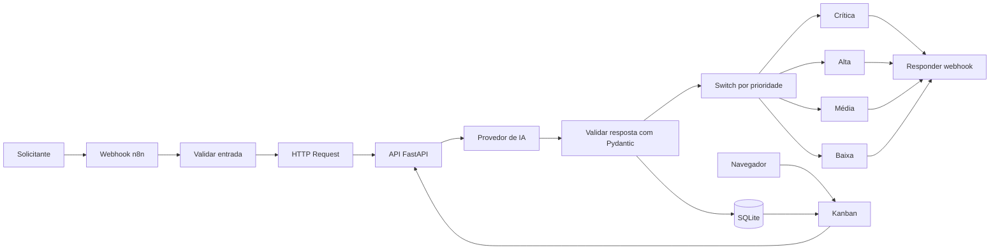
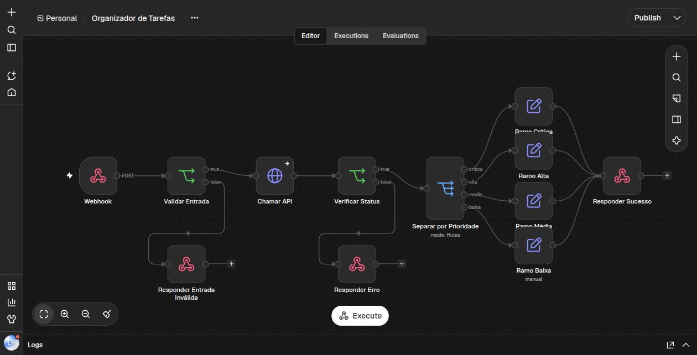
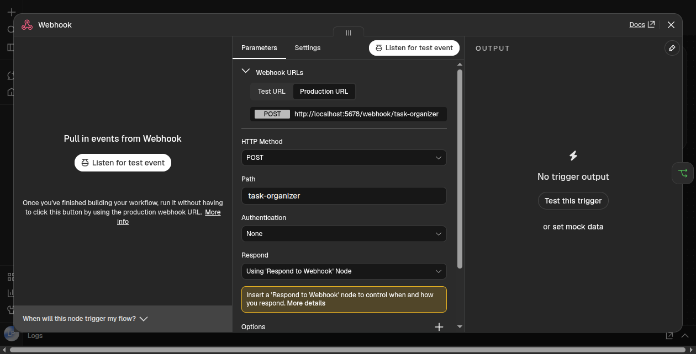
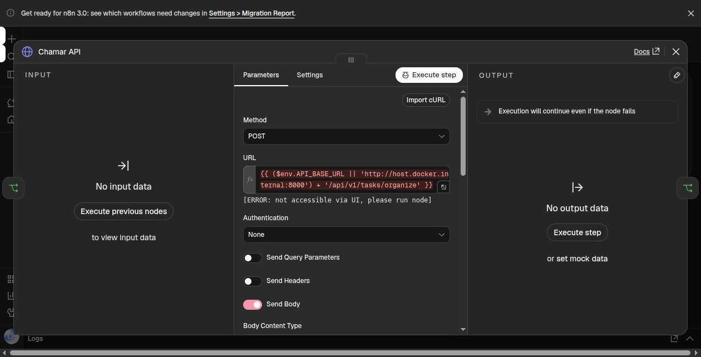
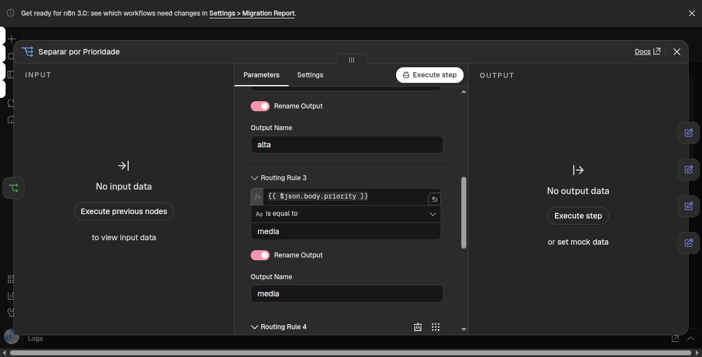
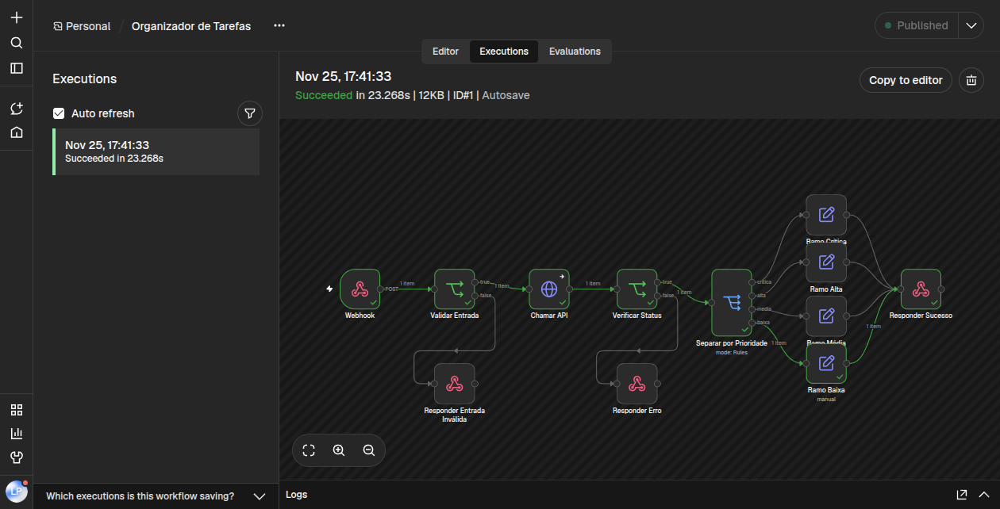
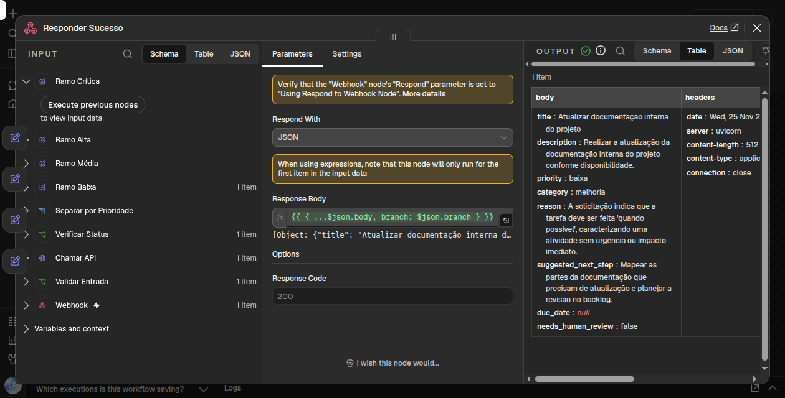

# Organizador Inteligente de Tarefas

API para transformar solicitações em linguagem natural em tarefas estruturadas,
com prioridade sugerida por IA, categoria, justificativa e próximo passo. O
projeto atende ao caso 4.3 — Organização de Tarefas — do desafio KODIE.

## Ideia e solução

Uma equipe recebe solicitações em texto livre e precisa interpretar o que deve
ser feito e qual a urgência. A API valida a solicitação, pede ao provedor de IA
que extraia os campos da tarefa e valida a resposta antes de devolvê-la. Um
workflow n8n pode receber solicitações via webhook, chamar a API e encaminhar
o resultado por prioridade. As tarefas também são salvas em SQLite e podem ser
organizadas em um quadro Kanban servido pela própria API.

A classificação é assistiva: a prioridade não é uma decisão infalível e a
equipe pode revisar a tarefa. O sistema não executa ações técnicas descritas
na solicitação nem se conecta a serviços externos de gestão de tarefas.

## Tecnologias

- Python 3.12
- FastAPI e Pydantic
- SQLite (biblioteca padrão do Python)
- HTML, CSS e JavaScript para a interface Kanban
- Cliente HTTPX para provedores compatíveis com a API OpenAI
- n8n para automação
- Docker Compose opcional para executar a API e o n8n juntos
- pytest para testes automatizados

## Arquitetura



O arquivo exportado do fluxo está em [`n8n/workflow.json`](./n8n/workflow.json).
Exemplos de entrada e saída estão em
[`docs/workflow/exemplos.md`](./docs/workflow/exemplos.md).

## API

### Saúde

```http
GET /health
```

Resposta `200`:

```json
{"status": "ok"}
```

O health check também verifica o armazenamento SQLite.

### Organizar tarefa

```http
POST /api/v1/tasks/organize
Content-Type: application/json
```

Requisição:

```json
{
  "request_text": "O sistema de pagamento está com erro para todos os clientes."
}
```

Resposta ilustrativa:

```json
{
  "title": "Investigar erro no sistema de pagamento",
  "description": "O sistema de pagamento está com erro para todos os clientes.",
  "priority": "critica",
  "category": "incidente",
  "reason": "A solicitação relata falha com impacto amplo.",
  "suggested_next_step": "Verificar o incidente e encaminhar à equipe responsável.",
  "due_date": null,
  "needs_human_review": false,
  "id": 1,
  "request_text": "O sistema de pagamento está com erro para todos os clientes.",
  "status": "todo",
  "created_at": "2026-11-25T12:00:00+00:00",
  "updated_at": "2026-11-25T12:00:00+00:00"
}
```

Prioridades: `critica`, `alta`, `media` e `baixa`. Categorias: `incidente`,
`correcao`, `funcionalidade`, `melhoria`, `administrativa` e `outro`. A data é
`null` quando não houver uma data explícita e inequívoca. O limite padrão para
`request_text` é 4.000 caracteres.

`POST /api/v1/tasks/organize` salva a mensagem original e a tarefa estruturada
no SQLite. Os campos `id`, `status`, `created_at` e `updated_at` identificam o
registro persistido. O estado inicial é `todo`; a prioridade sugerida é um
campo separado.

### Gerenciar tarefas

- `GET /api/v1/tasks` lista tarefas; filtros opcionais: `status` e `priority`.
- `GET /api/v1/tasks/{id}` consulta uma tarefa.
- `PATCH /api/v1/tasks/{id}` edita `title`, `description` e/ou `status`.
- `DELETE /api/v1/tasks/{id}` exclui a tarefa e responde `204`.

Estados: `todo`, `in_progress` e `done`. A aplicação web está disponível na
raiz (`http://localhost:8000`) e permite criar, editar, mover e excluir
cartões. O navegador também mostra a mensagem original e as sugestões da IA.

Erros de validação retornam `422` com o código `INVALID_REQUEST`. Falhas do
provedor retornam `502`; timeout retorna `504`. As respostas de erro não
incluem credenciais nem detalhes internos do provedor.

## Pré-requisitos

- Python 3.12 e `venv` para executar localmente.
- Docker e Docker Compose para executar API e n8n juntos.
- Uma chave e modelo compatíveis com o provedor escolhido para classificação
  real por IA. Os testes não precisam de chave nem fazem chamadas externas.

## Configuração e execução local

Crie o ambiente virtual, instale as dependências e copie a configuração de
exemplo:

```bash
python3.12 -m venv .venv
.venv/bin/python -m pip install -r requirements-dev.txt
cp .env.example .env
```

Edite `.env` localmente para configurar `AI_PROVIDER`, `AI_BASE_URL`,
`AI_MODEL` e `AI_API_KEY` para o seu provedor. `DATABASE_PATH` define o arquivo
SQLite (padrão local: `data/tasks.db`). Não versione `.env`. Para
executar sem uma chave, configure explicitamente `AI_PROVIDER=mock`; esse modo
retorna sempre prioridade `media` e `needs_human_review: true`, e serve apenas
para desenvolvimento e validação básica do contrato.

No Docker Compose, o caminho é `/data/tasks.db`, montado no volume persistente
`task_data`; a variável local `DATABASE_PATH` não altera esse caminho.

Inicie a API:

```bash
.venv/bin/uvicorn app.main:app --host 0.0.0.0 --port 8000
```

Endpoints úteis:

- Kanban: `http://localhost:8000`
- API: `http://localhost:8000/api/v1/tasks`
- Swagger: `http://localhost:8000/docs`
- Saúde: `http://localhost:8000/health`

Exemplo de chamada:

```bash
curl -X POST http://localhost:8000/api/v1/tasks/organize \
  -H 'Content-Type: application/json' \
  -d '{"request_text":"Atualizar a documentação interna quando possível."}'
```

## n8n

Com Docker Compose, a API e o n8n são iniciados juntos. Configure as variáveis
de IA em `.env`; para iniciar sem provedor externo:

```bash
AI_PROVIDER=mock docker compose up -d --build
```

O n8n fica disponível em `http://localhost:5678`. No primeiro acesso, crie o
usuário proprietário local. Importe [`n8n/workflow.json`](./n8n/workflow.json)
pela interface do n8n e ative o workflow, se necessário. O webhook de produção
é:

```text
POST http://localhost:5678/webhook/task-organizer
```

Exemplo:

```bash
curl -X POST http://localhost:5678/webhook/task-organizer \
  -H 'Content-Type: application/json' \
  -d '{"request_text":"Atualizar a documentação interna quando possível."}'
```

No Compose, o workflow usa `API_BASE_URL=http://api:8000`. Fora do Compose,
quando o n8n roda em Docker e a API no host, a URL padrão do workflow é
`http://host.docker.internal:8000`.

Comandos úteis:

```bash
docker compose ps
docker compose logs -f
docker compose down
```

O Compose mantém os volumes `n8n_data` e `task_data`; `docker compose down` não
os remove. `docker compose down -v` apaga também os dados persistidos.

## Testes

```bash
.venv/bin/python -m pytest -v
```

Os testes cobrem endpoints, persistência SQLite, CRUD, validações, categorias e
prioridades, resposta inválida da IA, timeout e falhas do provedor. Os testes
usam banco temporário e simulam chamadas à IA; nenhuma chamada paga é necessária.

## Evidências visuais

O diagrama Mermaid acima apresenta o fluxo lógico; as capturas abaixo foram
feitas na interface local do n8n.



*Workflow completo: comprova as conexões entre entrada, tratamento de erro e os
quatro ramos de prioridade.*



*Webhook: comprova o método POST, o caminho `task-organizer` e a resposta pelo
node dedicado.*



*HTTP Request: comprova a chamada POST à rota `/api/v1/tasks/organize` e o
tratamento de respostas HTTP. O endereço usa `API_BASE_URL`; o editor não
resolve essa variável no preview, mas ela é lida pelo node em execução.*



*Switch: comprova a configuração dos ramos `critica`, `alta`, `media` e
`baixa`.*



*Execução: comprova uma chamada real concluída em `200`, percorrendo o ramo
`baixa`. Foi usada uma solicitação fictícia.*



*Dados processados: mostra os campos estruturados e o valor `branch: baixa`
devolvidos pelo workflow.*

Uma solicitação real foi enviada ao provedor Google para capturar a execução;
chamadas futuras podem gerar custos conforme a configuração da conta.

## Limitações conhecidas

- A persistência é local ao servidor: não há sincronização entre instâncias ou
  máquinas.
- O modo `mock` não classifica o conteúdo e sempre pede revisão humana.
- A classificação real depende de um provedor compatível, de configuração
  válida e de conectividade externa.
- O n8n apenas demonstra ramificações locais; integrações reais com Jira,
  Trello, Slack, e-mail ou outros serviços estão fora do escopo do MVP.
- Não há autenticação de usuários, controle de acesso ou atribuição definitiva
  de responsáveis; não exponha a interface ou API a redes não confiáveis.
- O webhook do n8n não exige autenticação; não o exponha a redes não confiáveis.

## Segurança e configuração

- Mantenha credenciais somente em variáveis de ambiente ou no `.env` local.
- Não inclua chaves, dados pessoais ou credenciais na exportação do workflow.
- Trate a prioridade como sugestão e revise tarefas ambíguas.
- O texto do solicitante é enviado como dado do usuário; ele não pode escolher
  URLs, executar código ou disparar integrações.
